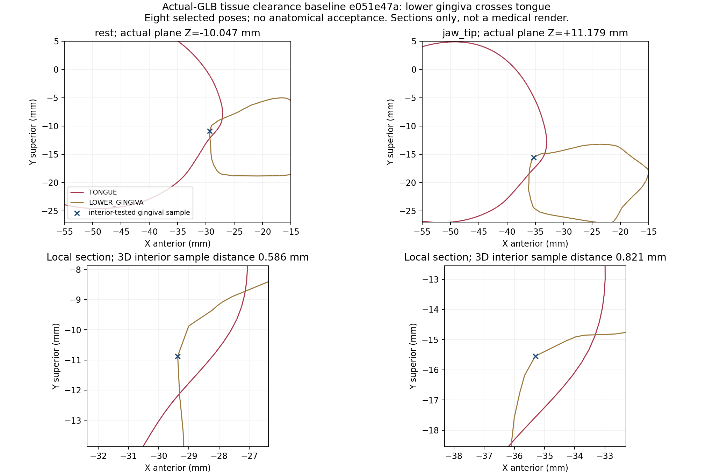

# Selected tissue contact baseline

Actual GLB SHA-256: `e051e47ad424a3d301f12acd75325998d6079007c3babd78175a31bbf563e0c6`.
Manifest SHA-256: `973e05fae49f187368ba575a9fda9ef0fdb9acedaa910d9c605a7403630bc0d7`.

**Failed:** 8 of 24 forbidden tongue/tissue surface pairs; all failures are lower gingiva in the eight selected states. Palate and upper gingiva are separated in all selected states. This is independent of the previously passed dental-arch tests.

| State | Lower gingiva triangle contacts | Actual proper intersection segments | Maximum finite interior sample distance (mm) |
|---|---:|---:|---:|
| rest | 809 | 807 | 0.586 |
| TIP_ELEVATE_1 | 541 | 541 | 0.599 |
| DORSUM_ELEVATE_1 | 110 | 108 | 0.126 |
| ROOT_RETRACT_1 | 653 | 651 | 0.466 |
| JAW_OPEN_0.5 | 536 | 536 | 0.345 |
| JAW_OPEN_1 | 762 | 760 | 0.556 |
| jaw_tip | 483 | 483 | 0.821 |
| source_combined | 366 | 366 | 0.389 |

The largest finite sample distance is 0.821 mm for `JAW_OPEN=.65, TIP_ELEVATE=.8`. The gingival surface sample at `[-35.306, -15.549, +11.179] mm` is classified inside the closed tongue; its nearest tongue point is `[-34.917, -15.838, +11.842] mm`. This is a sampled lower bound, not an exact penetration-depth measurement.

One actual rest intersection point is `[-39.713, -11.929, -15.659] mm`; it lies on both delivered triangles to numerical precision. The rest crossing extends over `X[-41.438,-19.328], Y[-13.444,-6.132], Z[-16.384,+16.384] mm`. In the jaw/tip combination it shifts posterior/inferior to `X[-46.360,-31.801], Y[-18.599,-9.711], Z[-16.863,+16.863] mm`.

Next geometric fix: shape the lateral/ventral tongue margin against the measured lingual boundary of the lower gingiva across jaw and tongue states, while retaining the free tip, organic volume and intended basal/ventral attachments. This is a local fit constraint; clearing it alone does not approve the anatomy. Do not move source teeth/gingiva or hide crossings.

All delivered parts in these evaluated cases are closed and consistently wound with positive Trimesh volumes. Containment is skipped if the opposing mesh does not meet that condition. The 16 tongue/floor and tongue/frenulum pair checks are reported separately as attachment-interface diagnostics; no arbitrary overlap is accepted, and they never produce an anatomy pass. No contact budget was saturated.

FCL `contact.pos` sometimes lies on only one intersecting triangle. The report therefore separates those positions from intersection segments computed from both triangles. Nearest/inside Trimesh queries use numerical millimetres to avoid absolute-tolerance errors on small metre-unit triangles; all report distances/positions remain metres. Report witness residuals are below 1.5e-17 m.



The image shows actual planar sections at the selected sample Z coordinates, including a local view. The annotation states a **3D** nearest distance; it is not a projected 2D distance. The plot is a diagnostic, not a medical illustration.

Rerun a future candidate with:

```sh
.venv-qa/bin/python tools/qa/oral_tissue_contacts.py --folder artifacts/method-evidence/oral-sculpt/next --gate
```

The default evidence directory preserves this baseline: a different asset SHA writes a hash subdirectory. `--asset`, `--manifest`, and `--out` allow explicit inputs/output. A gate pass field is `selectedForbiddenTissueSurfacePass`; it checks only the 24 selected forbidden surface pairs. This baseline intentionally exits 1 with `--gate`. The other 16 pairs remain diagnostic, and the finite interior measurements do not claim complete volume overlap or all combinations. The selected fixed cases are in the tool; return-to-rest, intermediate tongue states, phoneme contact, self-intersections and the full control space are outside this audit.

Attribution: BodyParts3D / DBCLS / Kousaku Okubo; Z-Anatomy / Gauthier Kervyn, CC BY-SA 4.0 dental/reference geometry; see assets/source/z-anatomy/NOTICE.md. Cross-section plot includes derived CC BY-SA 4.0 reference geometry; see [source notice](../../../../assets/source/z-anatomy/NOTICE.md).
